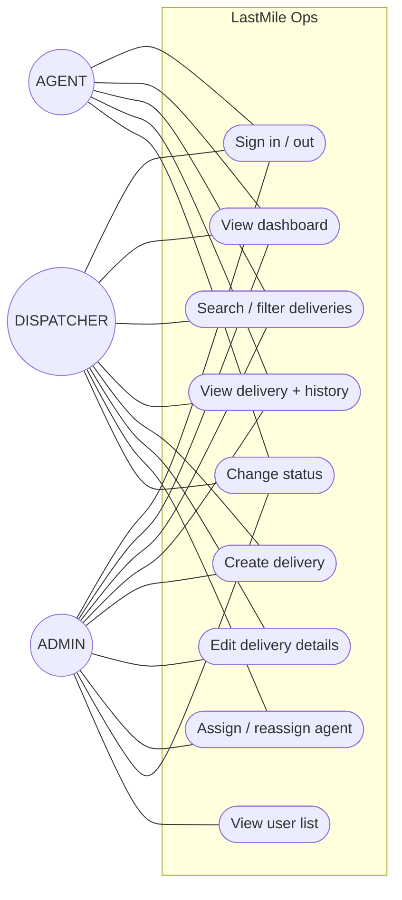
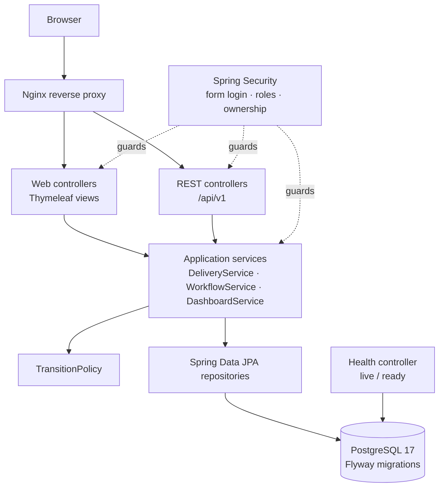
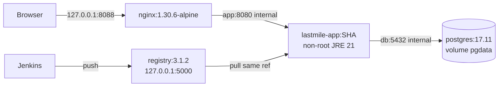

# Requirements Summary and Architecture (Teacher Task 3)

## 1. SRS summary

| Area | Requirement (source) |
|---|---|
| Users | ADMIN, DISPATCHER, AGENT; seeded dev-only accounts (PRD §6, §8) |
| Functional | Login/logout; delivery create/list/detail/edit/search/filter/paginate; assign/reassign; status workflow with history; role-scoped dashboard; admin read-only user list; health endpoints (`docs/user-stories.md` US1–US10) |
| Rules | State machine and role matrix (`Backend_Schema.md` §6–7; decisions D6–D8) |
| Data | `users`, `deliveries`, `delivery_status_history` (`Backend_Schema.md` §3) |
| Non-functional | BCrypt hashes, CSRF on forms, server-side authz, Flyway-only schema, UTC `timestamptz`, no secrets in Git, fictional data, responsive accessible UI (PRD §9, TRD §6) |
| DevOps | Jenkinsfile CI/CD, Selenium gate, versioned images, local registry, Ansible, rollback (TRD §9–11) |

## 2. Use-case diagram

AGENT use cases UC2–UC4 and UC8 apply only to deliveries assigned to that agent.

## 3. Logical architecture (modular monolith)

Packages: `config`, `security`, `user`, `delivery`, `workflow`, `dashboard`, `health`, `web`
(shared error handling). DTOs/forms are separate from JPA entities; entities are never serialized.

## 4. Data model

ERD: `docs/Backend_Schema.md` §2 (authoritative). Implemented by Flyway `V1__core_schema.sql`.
Additions within the documented model: `version` optimistic-lock column on `deliveries` (schema
marks it optional; adopted to prevent lost updates), `CHECK` constraints for role/status values.

## 5. Routes and API list

| Method | Path | Access |
|---|---|---|
| GET/POST | `/login`; POST `/logout` | Public / authenticated |
| GET | `/dashboard` | Authenticated (role-scoped) |
| GET | `/deliveries?q&status&agentId&page&size` | Authenticated (AGENT forced to own) |
| GET/POST | `/deliveries/new` | ADMIN, DISPATCHER |
| GET | `/deliveries/{id}` | Authenticated + ownership |
| GET/POST | `/deliveries/{id}/edit` | ADMIN, DISPATCHER |
| POST | `/deliveries/{id}/assignment` | ADMIN, DISPATCHER |
| POST | `/deliveries/{id}/status` | Role + ownership + transition |
| GET | `/admin/users` | ADMIN |
| GET | `/api/v1/health/live`, `/api/v1/health/ready` | Public (minimal payload) |
| GET/POST | `/api/v1/deliveries` | Authenticated / ADMIN, DISPATCHER |
| GET/PUT | `/api/v1/deliveries/{id}` | Authenticated + ownership / ADMIN, DISPATCHER |
| PATCH | `/api/v1/deliveries/{id}/assignment` | ADMIN, DISPATCHER |
| PATCH | `/api/v1/deliveries/{id}/status` | Role + ownership + transition |
| GET | `/api/v1/dashboard/summary` | Authenticated |

API authentication: same session (form login). For scripted calls, HTTP Basic is enabled **only**
for `/api/**` with CSRF ignored for `/api/**` (stateless clients cannot carry a CSRF token);
browser forms keep CSRF protection. Errors use the contract in `Backend_Schema.md` §9.

## 6. Selected topologies (single choice each)

### 6.1 Jenkins topology — container on Docker Desktop

- Image built from `ci/jenkins/Dockerfile`: `FROM jenkins/jenkins:2.580.1-lts-jdk21` + Docker CLI
  + Compose plugin + Chromium/chromedriver (for Selenium) + pinned plugin list.
- Published on `127.0.0.1:8090` only; persistent named volume `jenkins_home`; no inbound webhook
  (SCM polling, `H/5 * * * *`).
- Docker access through the mounted Docker Desktop socket. **This is root-equivalent**; acceptable
  only because Jenkins is local, single-user and not network-exposed.
- Builds use the Maven Wrapper with the container's JDK 21; integration and Selenium tests use
  embedded PostgreSQL, so CI does not need a database service.

Rejected: native Windows Jenkins (Windows service, path/line-ending drift, no Linux Docker CLI
parity). Recorded as decision D10.

### 6.2 Deployment topology — Docker Compose behind Nginx

- **Local environment (Phases 8–12):** Compose project `lastmile` on Docker Desktop, deployed by Jenkins.
- **Provisioned environment (Phases 13–14):** same Compose stack on the isolated Ubuntu target, configured by Ansible, pulling from the local registry over a host-only/trusted network. Exact registry address depends on BLOCKERS B4 and is proven in Phase 12/14 before being claimed.
- Only Nginx publishes a port. PostgreSQL publishes nothing (D1); the app port is internal.

### 6.3 Port map

| Port (host) | Service | Bound to |
|---|---|---|
| 8088 | Nginx → app (local deployment) | 127.0.0.1 |
| 8090 | Jenkins UI | 127.0.0.1 |
| 5000 | Local Docker registry | 127.0.0.1 (target access decided in Phase 12) |
| 15432 | Optional dev PostgreSQL access | 127.0.0.1, dev profile only |
| 5432 | **User's native PostgreSQL 16 — not used** | — |

All were free on 2026-10-19 except 5432.

## 7. Initial security and risk review

| Threat | Control |
|---|---|
| Agent reads/changes another agent's delivery | Repository queries scoped by principal; ownership check in service; 404 for foreign records; tests |
| Client sets status/actor/code/timestamps | Form/DTO objects exclude these fields; values set in services from principal and clock |
| CSRF on browser forms | Spring Security CSRF enabled for all non-API routes |
| Credential exposure | BCrypt; seed accounts only under `dev`/`test` profiles with passwords from env (dev default documented as non-production); `.env` git-ignored |
| SQL injection | JPA parameter binding only; no string-built queries |
| Information leakage | Generic login error; error pages without stack traces; health payload minimal; phone/address not logged |
| Jenkins/registry exposure | Bound to 127.0.0.1; Docker socket noted as root-equivalent |
| Supply chain | Checksums verified for JDK/Maven/wrapper; versions pinned; BOM-managed dependencies |

Unresolved decisions: BLOCKERS B4 (target), B6 (teacher questions).
