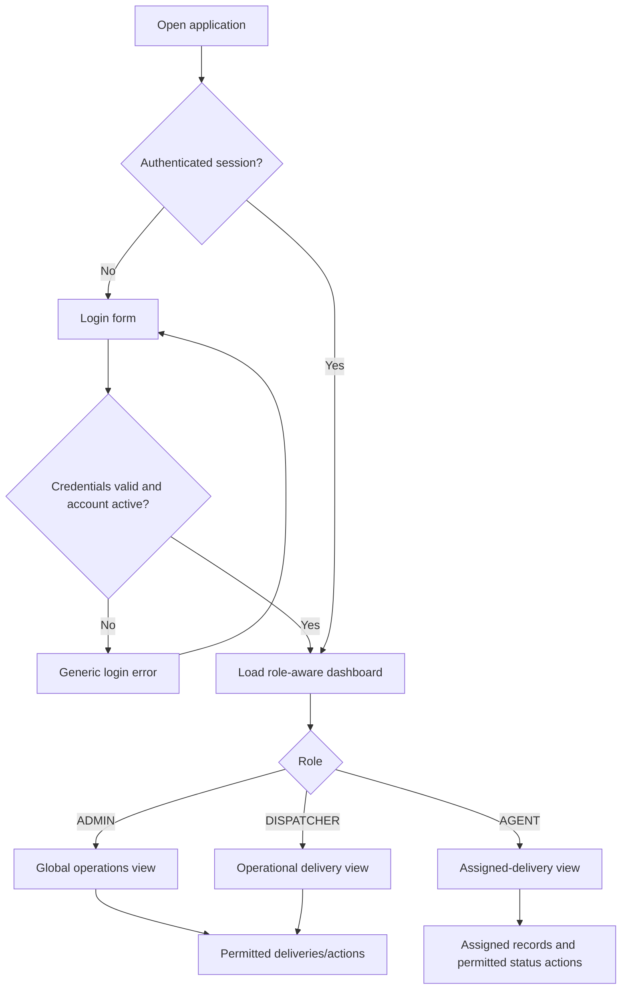
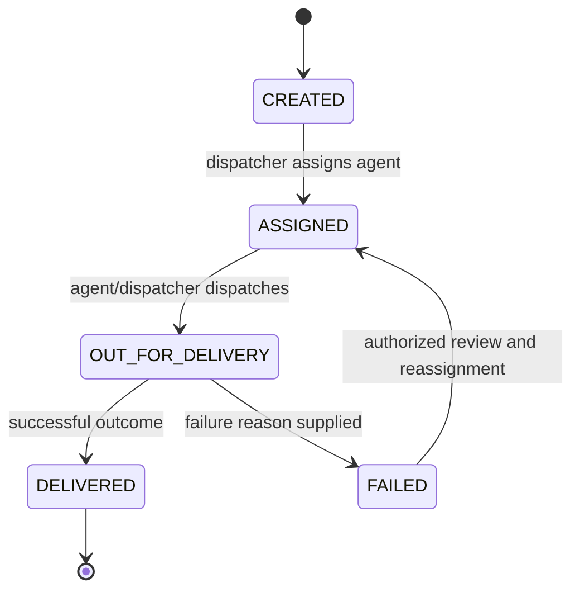
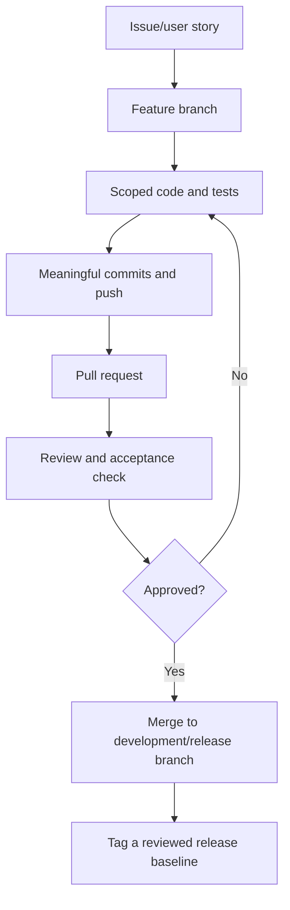
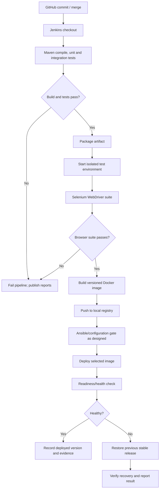

# Application Flow Specification

**Project:** Automated Last-Mile Delivery Management Platform  
**Version:** 1.1  
**Purpose:** Define user journeys, state transitions, error behavior and the commit-to-release flow before implementation.

## 1. Authentication and landing flow

Unauthenticated protected requests redirect to login for browser pages or return the expected authentication error for JSON endpoints. A disabled account cannot start a new operational session. Logout invalidates the session.

## 2. Delivery creation flow

1. An authenticated `ADMIN` or `DISPATCHER` opens the creation form.
2. User enters recipient name, phone, address, city and optional order/reference value; assignment is optional.
3. Server validates required fields, lengths and the phone number for the chosen country (India by default: exactly 10 digits; Backend_Schema.md §6.1), verifies any assigned agent exists, is active and has role `AGENT`, and checks uniqueness constraints.
4. Server creates a generated delivery code and initializes status to `CREATED`.
5. Record and initial status-history entry are persisted transactionally.
6. UI displays success and navigates to the new detail page.

If validation or persistence fails, the UI preserves the entered form values where safe, shows useful messages and does not show a success message. The client cannot choose ID, status, timestamps or the actor creating the history event.

## 3. View/search flow

1. User opens Deliveries.
2. Server determines role and authorized record scope.
3. Query parameters may include search term, status, assigned agent, page and page size.
4. Query is parameterized and returns a paginated result.
5. User opens a record only if permitted to view it.
6. No matches produce an empty state; query errors produce a distinct error state.

For an `AGENT`, server-side filtering by authenticated user must occur even when a crafted URL/query tries to select a different agent's records.

## 4. Edit/assignment flow

1. User opens a delivery and requests edit or assignment.
2. Server checks authentication, role, record existence and current state.
3. Only permitted non-system fields are accepted. Assignment may only reference an active `AGENT` account.
4. Server validates the new values and saves changes.
5. UI displays the updated record.

A normal edit must not rewrite history or change status as a side effect. Assignment/reassignment is an explicit action that updates the current `assigned_agent_id` and `updated_at`. The MVP audit trail records status transitions; a separate assignment-event table is optional and must not be added unless scope review explicitly approves it.

## 5. Delivery state machine

Rules:

- All requested transitions are checked against the current persisted state and the user's role/assignment.
- `FAILED` requires a non-empty reason.
- `DELIVERED` is terminal for the MVP.
- `FAILED` may return to `ASSIGNED` only after an explicitly authorized retry/reassignment decision.
- Successful status update and status-history insert happen in one database transaction.
- History actor comes from the authenticated principal, never from request JSON.
- Concurrent updates should not silently overwrite each other; use optimistic locking or a state check within a transaction if the final implementation warrants it.

## 6. Dashboard flow

1. Authenticated user opens Dashboard.
2. Backend resolves role/ownership scope.
3. Aggregation queries compute total and per-status counts from persisted deliveries.
4. UI displays the returned counts and optional recent records.
5. Selecting a metric navigates to a matching filtered delivery list if implemented.

No hard-coded numbers, mocked chart data or fabricated real-time metrics are allowed in the finished application. An agent sees only a summary of their assigned records, including permitted outcomes.

## 7. Error behavior

| Condition | Expected behavior |
|---|---|
| Invalid input | Show field/form validation; do not save invalid data. |
| Missing delivery | Show not-found state or return HTTP 404. |
| Unauthenticated request | Redirect page request or return API authentication response. |
| Unauthorized role/ownership | Reject request; do not reveal another agent's record details. |
| Invalid status transition | Return a clear conflict/validation response; keep status/history unchanged. |
| Database/readiness failure | Report unhealthy readiness and safe user-facing error; do not claim release healthy. |
| Selenium failure | Capture screenshot and useful browser/test evidence; fail the Jenkins quality gate. |
| Deployment health check failure | Do not mark the release successful; invoke or document recovery to the prior stable version. |
| Repeat Ansible run | No unintended changes; record output showing idempotency. |

## 8. Critical Selenium journeys

Choose 3–5 journeys and implement stable, deterministic test data. Recommended five:

1. Dispatcher logs in, creates a delivery and sees the generated delivery code.
2. Dispatcher searches for the new delivery and opens its detail page.
3. Dispatcher assigns an agent; that agent logs in and sees the delivery while a different agent cannot view it.
4. Agent advances an assigned delivery through allowed statuses; dashboard/details reflect the persisted result.
5. Invalid transition or failure without a reason is rejected; the record remains unchanged and a useful message is displayed.

Each test requires assertions—not just navigation—setup/cleanup or uniquely generated test data, screenshots on failure, and a report published by Jenkins. Tests should run headlessly in CI.

## 9. Git and release flow

Use a documented naming convention such as `feature/<short-name>`, `fix/<short-name>`, `docs/<short-name>` and `release/<version>` when needed. At least one feature should be developed via a reviewed PR; another feature branch should demonstrate a deliberately created and properly resolved merge conflict as required by the teacher. Do not create a conflict in generated/binary files.

## 10. End-to-end DevOps release flow

The exact Ansible stage placement depends on the selected target topology: it may prepare the node before deployment and/or verify service configuration after the image is available. Build, unit/integration and Selenium gates must all pass before activation of a new release. A failed health check must never be reported as successful deployment.

## 11. Rollback/recovery flow

1. Record the current version/image digest or immutable tag before replacing the running release.
2. Deploy the candidate image using parameterized configuration.
3. Wait for readiness within a bounded timeout.
4. If healthy, record the promoted image and deployment evidence.
5. If unhealthy, restore the previous known-good image and compatible runtime configuration.
6. Re-run readiness/health checks and record whether recovery succeeded.
7. Preserve logs; do not delete the old image until the new release is accepted.

Database migrations are a special risk: the first version should use backward-compatible additive migrations wherever practical. Document any migration that makes binary rollback unsafe. A Docker image rollback alone is not proof that database state has been recovered.
