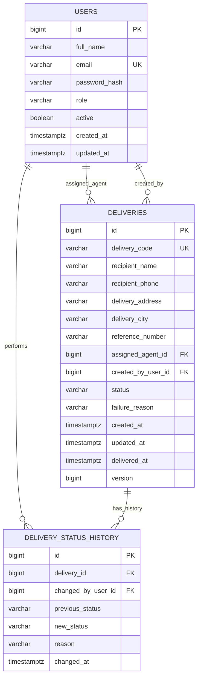

# Backend Schema and API Specification

**Project:** Automated Last-Mile Delivery Management Platform  
**Database:** PostgreSQL  
**ORM/migrations:** Spring Data JPA / Hibernate + Flyway  
**Version:** 1.1

## 1. Data model principles

- Use relational constraints for identity and referential integrity.
- Keep business rules in services; do not rely on UI-only constraints.
- Generate IDs, delivery codes, audit actors and timestamps on the server.
- Every successful status change must persist history in the same transaction.
- Use fictional/seeded data for demos and redact personal data from logs.
- Prefer deactivate/disable over deleting users referenced by historic deliveries.

## 2. Entity relationship overview



`version` is an optional optimistic-lock field (`@Version`) to reduce accidental concurrent overwrites. Confirm whether it is needed during implementation; if used, include it consistently in entity and migration.

## 3. Table specification

### 3.1 `users`

| Column | Type | Constraints / meaning |
|---|---|---|
| `id` | BIGINT | Primary key, generated identity |
| `full_name` | VARCHAR(120) | Required, trimmed |
| `email` | VARCHAR(255) | Required, normalized lowercase, unique |
| `password_hash` | VARCHAR(255) | Required, suitable password hash only |
| `role` | VARCHAR(30) | Required: `ADMIN`, `DISPATCHER`, `AGENT` |
| `active` | BOOLEAN | Required, default true |
| `created_at` | TIMESTAMPTZ | Server-set, UTC instant |
| `updated_at` | TIMESTAMPTZ | Server-maintained |

Seeded users are for local/dev/test. Provide a safe first-run strategy that does not force a production default password. Do not add a demo password to a public deployment configuration.

### 3.2 `deliveries`

| Column | Type | Constraints / meaning |
|---|---|---|
| `id` | BIGINT | Primary key, generated identity |
| `delivery_code` | VARCHAR(40) | Required, unique, generated by server |
| `recipient_name` | VARCHAR(120) | Required |
| `recipient_phone` | VARCHAR(20) | Required; per-country validation, stored as E.164 (section 6.1) |
| `delivery_address` | VARCHAR(500) | Required |
| `delivery_city` | VARCHAR(100) | Required |
| `reference_number` | VARCHAR(100) | Optional external order/reference identifier |
| `assigned_agent_id` | BIGINT | Nullable FK to `users.id`; if set, user must be active role `AGENT` |
| `created_by_user_id` | BIGINT | Required FK to `users.id`; derived from authenticated principal |
| `status` | VARCHAR(30) | Required; valid enum/state value |
| `failure_reason` | VARCHAR(500) | Required when current status is `FAILED`; otherwise null/cleared by explicit policy |
| `created_at` | TIMESTAMPTZ | Server-generated |
| `updated_at` | TIMESTAMPTZ | Server-maintained |
| `delivered_at` | TIMESTAMPTZ | Set when transition to `DELIVERED` succeeds; otherwise null |
| `version` | BIGINT | Optional optimistic-lock version |

Do not store a history of status inside a comma-delimited column. Use a child table so events can be queried and audited.

### 3.3 `delivery_status_history`

| Column | Type | Constraints / meaning |
|---|---|---|
| `id` | BIGINT | Primary key, generated identity |
| `delivery_id` | BIGINT | Required FK to `deliveries.id` |
| `changed_by_user_id` | BIGINT | Required FK to `users.id`; derived from authenticated session |
| `previous_status` | VARCHAR(30) | Null only for initial creation if initial creation is recorded here |
| `new_status` | VARCHAR(30) | Required |
| `reason` | VARCHAR(500) | Optional unless the transition requires it; required for failure |
| `changed_at` | TIMESTAMPTZ | Server-generated UTC instant |

History entries should be append-only through application operations. No ordinary UI function should edit or delete an existing history event.

## 4. Relationships and integrity rules

- One active agent may be assigned multiple deliveries; each delivery has zero or one current assigned agent.
- Every delivery is created by one authenticated user.
- One delivery has zero or more status-history entries, including an initial `CREATED` event.
- Every history entry has one actor.
- `delivery_code` and normalized `email` are unique.
- An inactive account cannot perform actions; historical references remain intact.
- Restrict or carefully handle user deletion so history is never silently removed.
- For an assignment change, validate the target user role and activity. Record the assignment change through an explicit history/event strategy agreed during Phase 3; do not silently treat assignment as a status transition unless documented.
- When a delivery becomes `DELIVERED`, set `delivered_at`; on a permitted retry after `FAILED`, apply a documented policy to clear or retain failure metadata.

## 5. Indexes

Recommended starting indexes:

- Unique index on `users(email)` after normalization.
- Unique index on `deliveries(delivery_code)`.
- Index on `deliveries(status, created_at)` for operational lists.
- Index on `deliveries(assigned_agent_id, status)` for agent workload/dashboard.
- Index on `deliveries(created_by_user_id, created_at)` if used for audit/reporting.
- Index on `delivery_status_history(delivery_id, changed_at)` for detail timelines.

Search for recipient and reference fields can begin with case-insensitive database predicates for this small MVP. Add PostgreSQL-specific indexes only if needed and documented.

## 6. State machine and validation

Allowed transitions:

| Current | Next | Preconditions |
|---|---|---|
| `CREATED` | `ASSIGNED` | Dispatcher/admin assigns an active agent |
| `ASSIGNED` | `OUT_FOR_DELIVERY` | Authorized user; delivery is assigned and eligible |
| `OUT_FOR_DELIVERY` | `DELIVERED` | Authorized assigned agent/dispatcher; valid outcome |
| `OUT_FOR_DELIVERY` | `FAILED` | Authorized user; non-empty failure reason |
| `FAILED` | `ASSIGNED` | Authorized dispatcher/admin explicitly retries/reassigns |
| `DELIVERED` | — | Terminal in MVP |

Use a `DeliveryStatus` enum and a dedicated transition policy/service. Reject invalid transitions without modifying status/history. Status and history must be saved in one transaction. Map invalid transition/conflict to a clear response such as HTTP 409.

### 6.1 Recipient phone numbers (decision D21)

One rule (`PhoneNumbers`) serves the web forms, the JSON API and seed data; it is enforced on the server.

| Input | Rule |
|---|---|
| `phoneCountry` | ISO 3166 region code (`IN`, `GB`, `US`, ...), not a calling code: +1 alone cannot tell the US from Canada. Web forms default to `IN`. Must be a region in libphonenumber's metadata, otherwise the field error "Choose a country from the list." |
| `recipientPhone` (with a country) | The national number: digits only (no `+`, spaces, letters or punctuation). **India: exactly 10 digits.** Every country: must be a valid number for that country in libphonenumber's maintained metadata (9.0.41), which also decides lengths. A national trunk prefix where people write one (UK `07400…`) is accepted. A number typed with the country code or an international prefix (`919876…`, `+91…`, `0044…`) is refused with a message saying to leave the code out. |
| Blank | Only "Phone number is required." (no second message). |
| API without `phoneCountry` | Backwards compatible: `recipientPhone` is either full international (`+447400123456`) or an Indian 10-digit number. |

Storage: E.164 (`+919876543210`, at most 16 characters) in the existing `VARCHAR(20)` column — no migration.
The detail page shows the international format (`+91 98765 43210`); API responses return E.164. The edit form
recovers the country and national number from the stored value.

Existing data: values stored before this rule (v1.0.0 accepted any 7–15 digits with an optional `+`) are **not**
rewritten. They are displayed as stored; the edit form shows them as Indian national numbers, and they are
normalised (or rejected with a message) only when someone saves that delivery.

The country selector is a native `<select>` of every region in the metadata (about 245, shown as
"Country (+code)", sorted by name; typing a name jumps to it). It is not a type-to-filter search box.

## 7. Role/ownership matrix

| Operation | ADMIN | DISPATCHER | AGENT |
|---|---|---|---|
| List all deliveries | Yes | Yes | No; own assignment scope only |
| Create delivery | Yes | Yes | No |
| Edit non-system delivery fields | Yes | Yes | No |
| Assign/reassign | Yes | Yes | No |
| View delivery | All | Operational set | Assigned to self only |
| Update status | Audited override only if explicitly approved | Valid transitions | Valid transitions on own assigned delivery |
| View dashboard | Global | Operational summary | Own assignment summary |
| List/change users | Minimal admin-only scope if approved | No | No |

Security must be checked in server-side endpoint/service logic. Hiding a button, trusting a request-supplied actor ID or trusting an `assignedAgentId` without role validation is insufficient.

## 8. API contracts

Primary UI uses server-rendered routes; documented JSON endpoints share the same application services.

| Method | Endpoint | Request / response notes |
|---|---|---|
| `GET` | `/api/v1/health/live` | Process liveness; minimal safe payload |
| `GET` | `/api/v1/health/ready` | Readiness check including required database dependency |
| `GET` | `/api/v1/deliveries` | Query: `q`, `status`, `agentId` (role-restricted), `page`, `size`; returns paginated DTOs |
| `POST` | `/api/v1/deliveries` | Recipient/address/reference/optional agent; server sets code, status, creator and timestamps |
| `GET` | `/api/v1/deliveries/{id}` | Scoped delivery DTO plus permitted history |
| `PUT` | `/api/v1/deliveries/{id}` | Editable business fields only; exclude status/audit/system fields |
| `PATCH` | `/api/v1/deliveries/{id}/assignment` | Assignment ID; actor is authenticated user |
| `PATCH` | `/api/v1/deliveries/{id}/status` | New status and optional reason; actor is authenticated user |
| `GET` | `/api/v1/dashboard/summary` | Counts within the current user's scope |

Example create request:

```json
{
  "recipientName": "Aarav Sharma",
  "phoneCountry": "IN",
  "recipientPhone": "9876543210",
  "deliveryAddress": "Example Street, Apartment 12",
  "deliveryCity": "Mumbai",
  "referenceNumber": "ORD-1001",
  "assignedAgentId": null
}
```

Example status request:

```json
{
  "newStatus": "FAILED",
  "reason": "Recipient unavailable"
}
```

The API must not accept client values for generated delivery code, ID, creator, status-history actor, timestamps or optimistic-lock fields unless a deliberately documented concurrency protocol requires a token.

## 9. Standard error contract

- `400 Bad Request`: malformed request or field validation failure.
- `401 Unauthorized`: authentication is required/invalid.
- `403 Forbidden`: authenticated user lacks permission.
- `404 Not Found`: record not found within policy-safe behavior.
- `409 Conflict`: invalid transition, uniqueness/state conflict or optimistic-lock conflict.
- `500 Internal Server Error`: unexpected fault; return safe message and correlation/reference ID if implemented.

UI validation should be field-specific where possible. Do not expose SQL, stack traces, credentials or internal configuration.

## 10. Migration and seed-data policy

- Store incremental migrations under Flyway's standard migration directory and commit them.
- Test a fresh database startup and migration application.
- Do not use Hibernate `create`/`update` as the deployment schema-management strategy.
- Seed data via an explicit dev/test profile or documented local command; prevent default demo credentials from becoming production defaults.
- Keep seed records synthetic. Make Selenium tests deterministic through test fixtures or cleanup/unique test data.

## 11. Schema acceptance checklist

- Fresh database migrations succeed.
- Foreign keys and unique constraints behave as expected.
- Invalid enum/state data is rejected at application boundary and, where appropriate, at schema boundary.
- Every successful state transition creates one history entry in the same transaction.
- Failed transition creates no state/history change.
- Agent data scoping is enforced for list, detail and status update.
- Dashboard counts agree with direct test queries.
- A re-run of the application against an existing schema does not recreate/drop tables unexpectedly.
