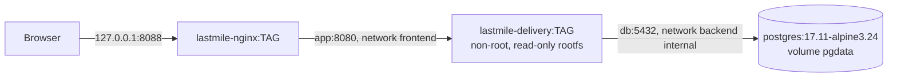

# Deployment

## Stack



Defined in `deploy/compose.yaml` (project name `lastmile`). `TAG` is the 12-character commit SHA
of the build that passed all tests; `latest` is never used.

| Variable | Required | Meaning |
|---|---|---|
| `LASTMILE_IMAGE_TAG` | yes | Image tag to deploy (commit SHA) |
| `LASTMILE_DB_PASSWORD` | yes | PostgreSQL password (Jenkins credential `lastmile-db-password`) |
| `LASTMILE_IMAGE`, `LASTMILE_NGINX_IMAGE` | no | Image names (default: local registry names) |
| `LASTMILE_HTTP_PORT` | no | Host port on 127.0.0.1 (default 8088) |
| `SPRING_PROFILES_ACTIVE` | no | `prod` (default) or `demo` |
| `LASTMILE_DEMO_PASSWORD` | demo only | Password for fictional demo accounts (credential `lastmile-demo-password`) |

## Deploy through Jenkins (normal path)

Merge to `main` (the only deployment branch; `develop` builds, tests and publishes images) or use
*Build with Parameters*. The pipeline builds and tests, packages both images with the commit tag,
runs `docker compose up -d --wait`, then verifies readiness through Nginx and that the running
app's `org.opencontainers.image.revision` label equals the commit. Any failure before *Deploy*
skips deployment.

## Manual deploy (PowerShell, for troubleshooting)

```powershell
$env:LASTMILE_IMAGE = "lastmile-delivery"; $env:LASTMILE_NGINX_IMAGE = "lastmile-nginx"
$env:LASTMILE_IMAGE_TAG = "<commit tag>"
$env:LASTMILE_DB_PASSWORD = "<from ci/jenkins/.env>"
docker compose -f deploy/compose.yaml up -d --wait
docker compose -p lastmile ps
curl.exe http://127.0.0.1:8088/api/v1/health/ready
```

## Health

- Liveness: `/api/v1/health/live` (process only).
- Readiness: `/api/v1/health/ready` (includes the database); used by the container `HEALTHCHECK`,
  `compose --wait` and the pipeline's verification stage.
- Nginx: `/nginx-health` (Nginx itself only).

## Data

PostgreSQL data lives in the named volume `lastmile_pgdata`; images contain no data. Flyway applies
migrations at application start. `docker compose -p lastmile down` keeps the volume; `down -v`
deletes it (destructive — never part of the pipeline).
