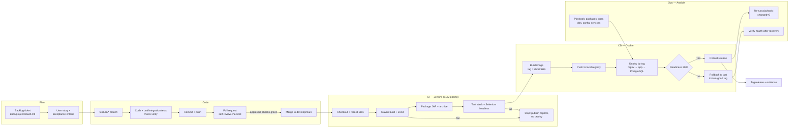

# Development-to-Operations Workflow (Teacher Task 2)

## Evidence produced at each stage

| Stage | Evidence (stored under `docs/evidence/`) | Task |
|---|---|---|
| Plan | Board, stories, DoD | T1–T2 |
| Code | Branch graph, commits, PR, conflict transcript, tag | T4–T6 |
| CI | Jenkins console logs, poll log, archived JAR, JUnit report | T7 |
| Pipeline | Jenkinsfile stage view, parameter value, health output | T8 |
| Selenium | Test plan, report, failure screenshot | T9–T10 |
| Docker | Lifecycle transcript, `docker inspect`, image ID/digest | T11 |
| Registry/CD | Catalog/tags, pull log, deployed version = SHA | T12 |
| Ansible | Run 1 and run 2 recaps | T13–T14 |
| Recovery | Failed candidate, rollback, health result | T14 |
| Release | `docs/evidence/INDEX.md` | T15 |
